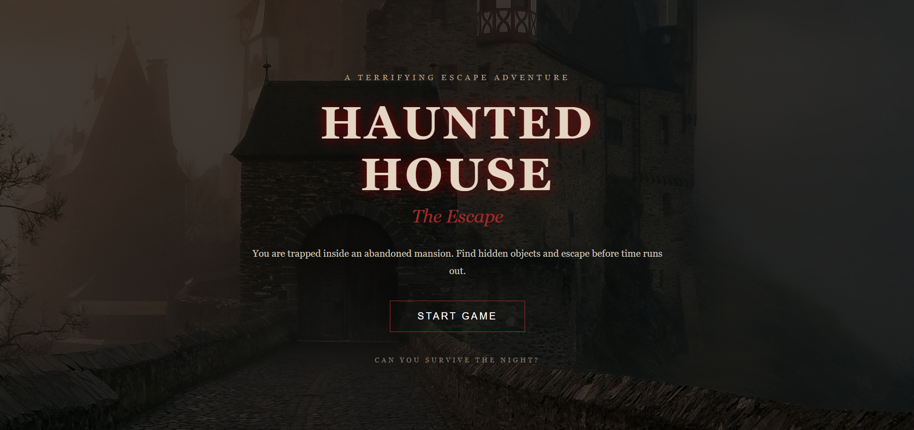

# Haunted House Mystery

**Name:** Samira Islam Kanta  
**Student ID:** 11230321317

## About the Game

Haunted House Mystery is a horror-themed hidden object adventure game developed using HTML, CSS, and JavaScript. The player explores multiple haunted rooms, discovers hidden objects, solves puzzles, and uncovers mysteries to escape the haunted house.

## How to Play

- Click the **Start Game** button to begin.
- Use the mouse to explore the room and find hidden objects.
- Click on hidden objects to collect them.
- Solve puzzles to discover clues and unlock further rooms.
- Keep an eye on the countdown timer.
- Avoid incorrect clicks to prevent time penalties.
- Complete the challenges to progress through the game.

## Features

- Horror-themed haunted house environment.
- Multiple haunted rooms.
- Hidden-object searching.
- Individual object images with transparent backgrounds.
- Puzzle-solving challenges.
- Countdown timer for each room.
- Score tracking system.
- Incorrect-click detection.
- Time penalty system.
- Inventory system.
- Room progression.
- Game-over screen.
- Restart option.

## Screenshots

### Gameplay

